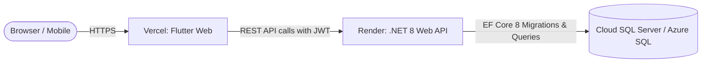

# FirstHome Nigeria — Render Backend Deployment Guide

This guide provides complete, step-by-step instructions for hosting the **FirstHome Nigeria** ASP.NET Core 8 Web API backend on **[Render](https://render.com)**.

---

## Architecture Overview



- **Backend Container**: Runs in Render as a Docker Web Service on .NET 8.
- **Port Mapping**: Render dynamically assigns a port via the `$PORT` environment variable (e.g. `10000`), which the API automatically binds to.
- **Auto-Migration**: On startup, Entity Framework Core automatically executes `await db.Database.MigrateAsync()` and seeds initial categories and test accounts.
- **Health Check**: Render monitors `/api/health` for zero-downtime health checking.

---

## Prerequisites: Cloud SQL Server Database

Render hosts the backend Web API container, but your application requires a **Microsoft SQL Server** database. Choose one of these cloud options:

### Option A: Azure SQL Database (Recommended — Free Tier)
Microsoft offers a 100% free serverless tier:
1. Log in to the [Azure Portal](https://portal.azure.com).
2. Create an **Azure SQL Database** (select the **Free Tier: 100,000 vCore seconds/month**).
3. Under **Set Firewall Rules**, toggle **"Allow Azure services and resources to access this server"** to **Yes**, or add `0.0.0.0` - `255.255.255.255`.
4. Copy the ADO.NET Connection String:
   ```text
   Server=tcp:your-server.database.windows.net,1433;Initial Catalog=FirstHomeDb;Persist Security Info=False;User ID=your_username;Password=your_password;MultipleActiveResultSets=False;Encrypt=True;TrustServerCertificate=False;Connection Timeout=30;
   ```

### Option B: Railway / Cloud VPS MSSQL
If you run SQL Server on Railway, Docker, or a Linux VPS, your connection string will look like:
```text
Server=your-host.railway.app,1433;Database=FirstHomeDb;User Id=sa;Password=YourStrongPassword;TrustServerCertificate=True;MultipleActiveResultSets=true
```

---

## Deployment Method 1: Render Blueprints (Fastest & Automated)

The repository includes a pre-configured [`render.yaml`](render.yaml) file.

1. Push your latest code to your GitHub repository:
   ```bash
   git add .
   git commit -m "Configure Render Dockerfile and Blueprint"
   git push origin main
   ```
2. Log in to your [Render Dashboard](https://dashboard.render.com).
3. Click **New +** &rarr; **Blueprint**.
4. Connect your GitHub repository (`rush-25/CI_FirstHome`).
5. Render will automatically detect `render.yaml`.
6. Fill in the prompted secret variables:
   - `ConnectionStrings__Default`: Paste your cloud SQL Server connection string.
   - `Cors__Origins__0`: Your Vercel frontend URL (e.g., `https://firsthome-nigeria.vercel.app` or `*`).
7. Click **Apply**. Render will build the Docker container and deploy the service!

---

## Deployment Method 2: Manual Setup via Render Dashboard

If you prefer to configure the Web Service manually:

### Step 1: Create New Web Service
1. In the Render Dashboard, click **New +** &rarr; **Web Service**.
2. Select **Build and deploy from a Git repository** and connect `rush-25/CI_FirstHome`.

### Step 2: Configure Service Settings
| Setting | Recommended Value |
| :--- | :--- |
| **Name** | `firsthome-api` *(or your preferred name)* |
| **Region** | Choose closest to your database (e.g., *Oregon (US West)* or *Frankfurt (EU)*) |
| **Branch** | `main` |
| **Root Directory** | Leave blank *(or `./`)* |
| **Runtime / Environment** | **Docker** |
| **Dockerfile Path** | `./Dockerfile` |
| **Instance Type** | **Free** *(or Starter)* |

### Step 3: Configure Environment Variables
Under the **Environment Variables** section, click **Add Environment Variable** for each:

| Key | Value | Description |
| :--- | :--- | :--- |
| `ASPNETCORE_ENVIRONMENT` | `Production` | Runs in production mode |
| `ConnectionStrings__Default` | *`Server=tcp:...`* | Your cloud SQL Server connection string |
| `Jwt__Key` | *Generate a 32+ char random string* | Secret signing key for JWT tokens |
| `Cors__Origins__0` | `https://your-frontend.vercel.app` | Allowed CORS origin (or `*`) |
| `Seed__AdminPassword` | `FhAdmin2026!Secure` | Custom admin password *(optional)* |
| `Seed__DemoPassword` | `FhDemo2026!Secure` | Custom demo account password *(optional)* |

> **Note on double underscores (`__`):** In ASP.NET Core, double underscores `__` represent nested configuration keys (e.g. `ConnectionStrings__Default` maps to `ConnectionStrings:Default`).

### Step 4: Health Check Path
1. Scroll down and expand **Advanced**.
2. In **Health Check Path**, enter:
   ```text
   /api/health
   ```
3. Click **Create Web Service**.

Render will now:
1. Pull the .NET 8 SDK image.
2. Build and publish `FirstHome.Api.csproj`.
3. Package it into the optimized ASP.NET Core runtime image.
4. Launch the container and execute database migrations.
5. Provide your live URL (e.g., `https://firsthome-api.onrender.com`).

---

## Step 5: Verify the Live Backend

Once the deployment finishes with status **Live**:

1. **Check Health**: Open `https://your-api.onrender.com/api/health` in your browser. You should see:
   ```json
   { "status": "ok", "time": "2026-10-26T05:00:00Z" }
   ```
2. **Explore Swagger UI**: Open `https://your-api.onrender.com/swagger` to inspect and test all API endpoints interactively.

---

## Step 6: Connect Your Frontend on Vercel

Now that your backend is live on Render:

1. Open your [Vercel Dashboard](https://vercel.com) &rarr; Select your `firsthome-nigeria` project.
2. Go to **Settings** &rarr; **Environment Variables**.
3. Update or add:
   - **Key**: `API_BASE_URL`
   - **Value**: `https://your-api.onrender.com/api`
4. Redeploy your Vercel project (or trigger a new build). Your Flutter frontend will now communicate directly with your live Render backend!

---

## Render Free Tier Notes

- **Spin down after inactivity**: Free web services on Render go to sleep after 15 minutes without inbound traffic. The first request after a sleep period may take ~30-50 seconds to wake up (cold start).
- **Keep-alive ping**: You can set up a free uptime monitor (such as [UptimeRobot](https://uptimerobot.com) or [Cron-job.org](https://cron-job.org)) to ping `https://your-api.onrender.com/api/health` every 10 minutes to prevent the service from sleeping.
