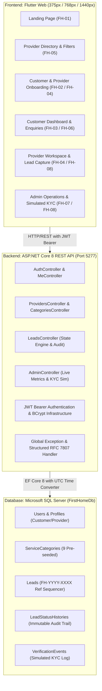
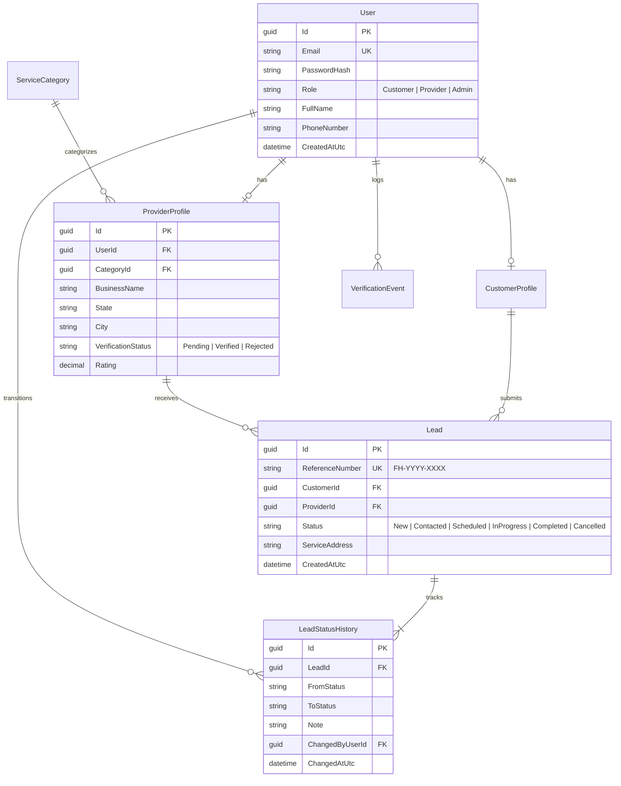
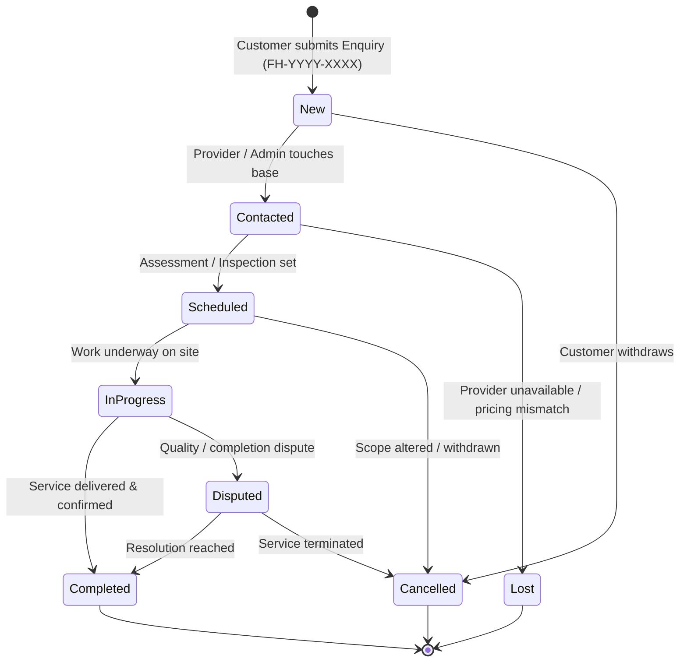

# FirstHome Nigeria — Customer & Service Provider Acquisition Platform
### Ceylon Innovation / Talent Assessment — Stage 1 Technical Architecture & Working Prototype
**Confidential • Candidate Submission Copy • October 2026**

> **Disclaimer:** *Concept Prototype — Subject to Final Scope & Commercial Agreement. All customer, provider, financial, and verification records are synthetic sample data generated solely for system demonstration. Strictly NO real Bank Verification Numbers (BVN), National Identification Numbers (NIN), live payment instruments, or real personally identifiable information (PII) are stored or processed.*

---

## 1. Executive Summary

**FirstHome Nigeria** is an end-to-end customer and service provider acquisition marketplace designed to bridge trust, quality, and transparent matchmaking for residential and commercial home services across Nigeria (focusing on major metropolitan hubs including Lagos, Abuja FCT, Rivers/Port Harcourt, Kano, and nationwide).

This repository implements the complete **Stage 1 Technical Prototype**, connecting a responsive **Flutter Web** client with a production-grade **ASP.NET Core 8 Web API** and local **Microsoft SQL Server (`FirstHomeDb`)** database via **Entity Framework Core 8**.

---

## 2. System Architecture

The architecture adheres to clean separation of concerns, strict domain modeling, deterministic audit history, and role-based security boundaries.



---

## 3. Data Model & Entity Relationships



---

## 4. Lead Lifecycle & State Transition Engine

Every customer enquiry produces a globally unique human-readable tracking reference (e.g. `FH-2026-0001`). State transitions are validated by the backend business rules engine and generate permanent audit snapshots in `LeadStatusHistories`.



---

## 5. Acceptance Gates Evaluation & Test Evidence

| Gate ID | Target Requirement | Implementation Details | Test Coverage | Status |
| :--- | :--- | :--- | :--- | :--- |
| **AT-01** | Customer Registration, Login & Lead Persistence | Customer registration hashes passwords via BCrypt, issues JWT, allows customer to submit direct enquiry with `FH-YYYY-XXXX` ref. | `AT01_Customer_Register_Login_And_Create_Lead_Success` | **PASS (Verified)** |
| **AT-02** | Provider Directory & Filtering | Public endpoint `/api/providers` supports filtering by `categoryId`, `state`, `city`, and free-text search. | `AT02_Provider_Directory_Returns_Active_Providers_With_Category_Filter` | **PASS (Verified)** |
| **AT-03** | Lead Status Transition & History Audit | Updating lead status automatically records previous state, new state, timestamp, and actor in `LeadStatusHistories`. | `AT03_Lead_Status_Transition_Creates_Audit_History` | **PASS (Verified)** |
| **AT-04** | Dynamic Database Summary Counts | `/api/admin/summary` computes live `COUNT()` aggregates across database tables (customers, providers, total leads, closed leads). | `AT04_Admin_Summary_Returns_Dynamic_Database_Counts` | **PASS (Verified)** |
| **AT-05** | Validation & Password Hashing | Enforces Nigerian phone formats, email uniqueness, strong password policies, and BCrypt work factor 11. | `AT05_Duplicate_Registration_Returns_400_Or_409` & `AT05_Invalid_Login_Fails` | **PASS (Verified)** |
| **AT-06** | Role-Based Access Control | Customer tokens receive 403 Forbidden on `/api/admin/*` endpoints; unauthorized requests return 401. | `AT06_Customer_Cannot_Access_Admin_Endpoints_Returns_403` & `AT06_Anonymous_Access_Returns_401` | **PASS (Verified)** |

### Automated Test Execution Results

#### Backend (.NET 8.0 xUnit Suite):
```bash
dotnet test backend/FirstHome.Tests
Passed!  - Failed: 0, Passed: 10, Skipped: 0, Total: 10, Duration: 2.1 s
```

#### Frontend (Flutter Web Widget & Responsive Suite):
```bash
cd frontend && flutter test
00:01 +4: All tests passed!
- Desktop layout (1440px) renders brand and landing sections
- Tablet layout (768px) renders without overflow
- Mobile layout (375px) renders without overflow
- Navigation to Login and Registration screens
```

---

## 6. Seeded Demo Accounts (1-Click Fill Ready)

For immediate review, test credentials have been pre-seeded into the local SQL Server database. The web application includes a **Quick Demo Credentials** 1-click fill drawer on the login page:

| Role | Account Name | Email Address | Password | Sample Focus |
| :--- | :--- | :--- | :--- | :--- |
| **Administrator** | FirstHome Admin | `admin@sample.firsthome.test` | `Fh4212091d1df34b1051A1` | Executive KPIs, lead oversight, simulated KYC approval/rejection |
| **Customer** | Adaeze Okafor | `customer01@sample.firsthome.test` | `Fh9ae89105ef00edd81bA1` | Lekki Phase 1, Lagos homeowner requesting plumbing & electrical |
| **Customer** | Babatunde Adeleke | `customer02@sample.firsthome.test` | `Fh9ae89105ef00edd81bA1` | Ikeja, Lagos tenant booking AC repairs |
| **Provider** | Lagos Pipe Masters | `provider01@sample.firsthome.test` | `Fh9ae89105ef00edd81bA1` | Verified Plumbing service in Lagos |
| **Provider** | CoolBreeze HVAC | `provider06@sample.firsthome.test` | `Fh9ae89105ef00edd81bA1` | Pending Air Conditioning service in Garki, Abuja |

---

## 7. Local Setup & Execution Guide

### Prerequisites
- Windows 10/11 or modern Linux/macOS
- .NET 8.0 SDK (`dotnet --version` >= 8.0)
- Flutter SDK 3.24+ (`flutter --version`)
- Microsoft SQL Server (Local, Express, or Developer edition)
- Python 3.10+ (for production web serving)

### Step 1: Database Setup
1. Ensure your local SQL Server instance is active at `localhost` or `(localdb)\mssqllocaldb`.
2. The default connection string in `backend/FirstHome.Api/appsettings.json` is:
   ```json
   "ConnectionStrings": {
     "DefaultConnection": "Server=localhost;Database=FirstHomeDb;Trusted_Connection=True;TrustServerCertificate=True;MultipleActiveResultSets=true"
   }
   ```
3. Run migrations and database seeder:
   ```bash
   dotnet ef database update --project backend/FirstHome.Api
   ```

### Step 2: Start the Web API Server
```bash
dotnet run --project backend/FirstHome.Api
```
The API server starts listening at **`http://localhost:5277`** (Swagger reference available at `http://localhost:5277/swagger`).

### Step 3: Run the Flutter Web Application
#### Option A: Production Web Build (Recommended & Verified)
```bash
cd frontend
python -m http.server 3000 --directory build/web
```
Open **`http://localhost:3000`** in Google Chrome or any modern browser.

#### Option B: Flutter Development Server
```bash
cd frontend
flutter run -d chrome --web-port 3000
```

---

## 8. REST API Reference

| Method | Endpoint | Access Role | Description |
| :--- | :--- | :--- | :--- |
| `POST` | `/api/auth/register` | Anonymous | Registers a new Customer or Provider account |
| `POST` | `/api/auth/login` | Anonymous | Authenticates credentials and returns JWT Bearer token |
| `GET` | `/api/me` | Authenticated | Fetches current user profile and role details |
| `GET` | `/api/categories` | Anonymous | Lists all 9 pre-seeded Nigerian home service categories |
| `GET` | `/api/providers` | Anonymous | Search & filter active verified service providers |
| `GET` | `/api/providers/{id}` | Anonymous | Fetches full public provider profile and ratings |
| `POST` | `/api/leads` | Customer | Generates a new lead with `FH-YYYY-XXXX` tracking ref |
| `GET` | `/api/leads/my` | Authenticated | Lists all leads linked to the calling Customer or Provider |
| `PATCH` | `/api/leads/{id}/status` | Provider, Admin | Validates transition and writes audit log to `LeadStatusHistories` |
| `GET` | `/api/admin/summary` | Admin Only | Live dynamic database aggregate metrics |
| `GET` | `/api/admin/customers` | Admin Only | Administrative customer database viewer |
| `GET` | `/api/admin/providers` | Admin Only | Administrative provider registry viewer |
| `POST` | `/api/admin/simulate-verification` | Admin Only | Simulates external KYC verification (Approved/Rejected) |

---

## 9. Design System & UI Specifications

The client interface is built upon a curated visual token architecture specifically selected to convey Nigerian homeownership confidence and institutional trust:

- **Warm Ivory (`#FAF8F2`):** Primary canvas background providing warmth without harsh stark whites.
- **Forest Green (`#174D3A`):** Dominant brand shade signifying growth, prosperity, and dependability.
- **Deep Evergreen (`#103B2D`):** High-contrast header, footer, and navigation backdrop.
- **Soft Sage (`#E7EFE8`):** Subtle surface accents, badges, and card boundaries.
- **Muted Gold (`#D6A653`):** Premium accent for verified checkmarks, ratings, and call-to-action highlights.
- **Typography:** Modern clean sans-serif typography with strict typographic scale from micro-badges (9px) to hero display titles (40px).
- **Responsive Viewport Compliance:** 
  - Mobile (375px): Zero horizontal scroll, adaptive compact navigation, stacked form headers.
  - Tablet (768px): Dual-column service cards, flex grid category selectors.
  - Desktop (1440px): Centered container max-width 1200px, multi-column analytics dashboards.

---

## 10. Regulatory & Identity Safety Statement

In strict adherence to Nigerian data protection principles and project safety requirements:
1. **No Real PII / No Real KYC Data:** The platform explicitly simulates KYC readiness. Neither the database schema nor API contracts request, accept, or store real Bank Verification Numbers (BVN) or National Identification Numbers (NIN).
2. **Deterministic References:** All customer leads and verification events use synthetic reference tokens (`FH-YYYY-XXXX`, `MOCK-BVN-XXXX`, `MOCK-NIN-XXXX`).
3. **Explicit Synthetic Consent:** Both registration and lead creation screens mandate affirmative consent acknowledging the demonstration sandbox nature of the system.
